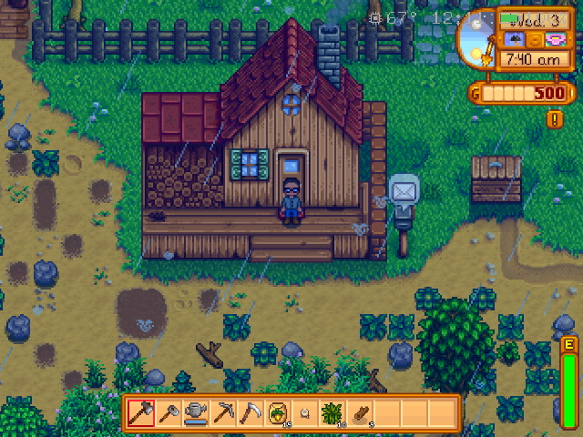

# Stardew Valley for goodluckOS



Stardew Valley, natively on the GA36-MB (Allwinner A33, 32-bit ARM, Mali-400, 512 MB of RAM) under [goodluckOS](https://github.com/CodeZombie/goodluckOS). The PC build from Steam's "compatibility" branch (1.6.15) is a .NET Framework program, so it runs on Mono, built here for 32-bit ARM. PortMaster's port supplies the rest: JohnnyonFlame's MonoGame, which streams the music from the card instead of RAM, and gl4es, which turns the game's OpenGL into OpenGL ES 2. This port's patches cut work the game repeats every frame, and the save serializers are generated ahead of time. About 19 FPS on the farm, the title screen in ~20 s, a save loaded in ~55 s.

**Nothing of the game is in this repository or in its releases.** You bring your own copy: Stardew Valley on Steam, switched to the compatibility branch, in its macOS or Linux version (the one with `StardewValley.exe`). The console makes the rest from it.

Status: work in progress, tested on one GA36-MB (A33) only.

## Installing

It needs a goodluckOS with the App Installer (System Settings > System > App Installer).

1. **The port.** Download `StardewValley-<version>.zip` from [Releases](https://github.com/alvesmaicon/glOSports-stardew/releases), copy it to the `apps` folder of the console's HOME (over USB, where the console shows up as a drive, or with the card in a card reader) and install it in the App Installer. Two entries show up in the Games tab: Stardew Valley and Add your Stardew Valley.
2. **Your game.** In Steam, open Stardew Valley's Properties > Betas and pick `compatibility`; once it has downloaded, Manage > Browse local files shows its folder. Copy that folder to the root of HOME, as it is or as a zip of it (one zip goes over USB much faster than thousands of files). It has to be the macOS or the Linux version: the Windows one isn't supported yet.
3. **On the console,** open Add your Stardew Valley. It finds the copy, moves it into the app (a zip is unpacked, then deleted) and gets it ready: the port's patches are built against your game, its images are repacked so that it starts faster, and the readers of its saves are made ahead of time. This takes a while, once. When it is done the entry goes away and Stardew Valley is ready, with your game's title logo as its icon.

The game follows the launcher's language. Saves stay in `HOME/.config/StardewValley`, outside the app. A newer zip updates the port the same way, and your game stays; uninstalling the app removes the game's copy but not the saves. Logs: `HOME/logs/stardew.log` and `HOME/logs/stardew-import.log`.

## Building

On a PC with Docker (Intel or Apple Silicon; on a Mac, Colima or Docker Desktop):

```sh
./build.sh          # the runtime in out/stardewvalley: Mono, gl4es, OpenAL Soft, MonoGame and the port's tools
./build.sh app      # the App Installer's zip, out/StardewValley-<version>.zip
tools/apptest.sh    # the zip's import of a game (SDV_GAME) in a HOME of its own, under qemu-arm
```

`./build.sh game` and `./build.sh xmlgen` make the game's files on the PC instead, for the benchmarks in `tools/`.

## Layout

| | |
|---|---|
| `build.sh`, `Dockerfile` | the build, in the `glosports-stardew` image; downloads and build trees in the `stardew-work` volume |
| `app/` | the app: `app.puppy`, `stardew.sh` (starts the game), `import.sh` (Add your Stardew Valley), `common.sh`, its own icon (`tools/icon.py`) |
| `patches/` | the port's C#: JohnnyonFlame's game patches and loader with this port's changes, the CPU patches (`SpeedPatches.cs`), the serializer generator, the LZ4 recompressor and the icon maker |
| `native/` | the LZ4 shim for 32-bit ARM, a GSSAPI stub for Mono, an OpenAL tone check |
| `test/HelloMG.cs` | a MonoGame check without the game |
| `tools/` | the import test (`apptest.sh`), benchmarks on the console over its serial port (`console.sh`) and on the PC (`macbench.sh`, in its own image, `bench.Dockerfile`), and their readers |

## Credits

Stardew Valley is ConcernedApe's, and the copy is yours. The port is built on [PortMaster's](https://github.com/PortsMaster/PortMaster-New) port of the game: JohnnyonFlame's MonoGame with streamed audio (the MonoGame Team, Ms-PL) and his loader and game patches, [gl4es](https://github.com/ptitSeb/gl4es) by ptitSeb and Ryan Hileman (MIT), [Mono](https://www.mono-project.com/) (MIT, some parts BSD-3-Clause), [OpenAL Soft](https://github.com/kcat/openal-soft) (LGPL 2) and [lz4](https://github.com/lz4/lz4) (BSD-2-Clause). Their license files are in the app's `licenses` folder, with Harmony's (MIT).

## License

This repository is MIT ([LICENSE](LICENSE)). `patches/StardewPatches.cs` and `patches/SVLoader.cs` start from JohnnyonFlame's sources, under his BSD license ([licenses/LICENSE.JohnnyonFlame.txt](licenses/LICENSE.JohnnyonFlame.txt)).
